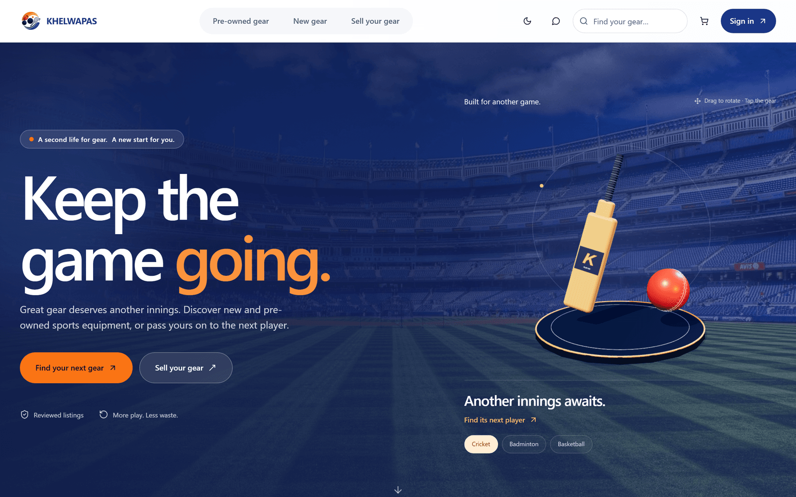
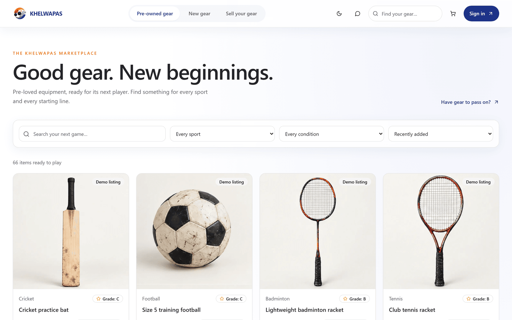
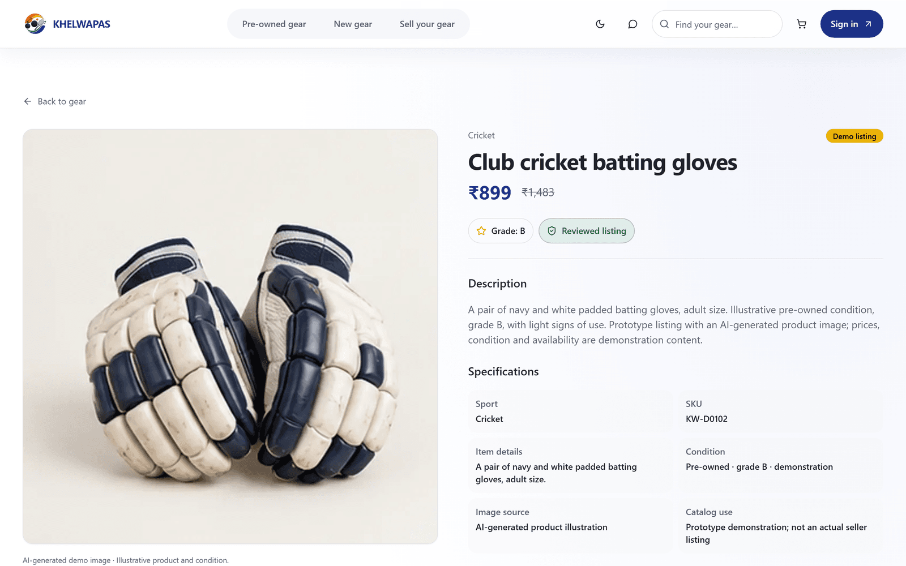
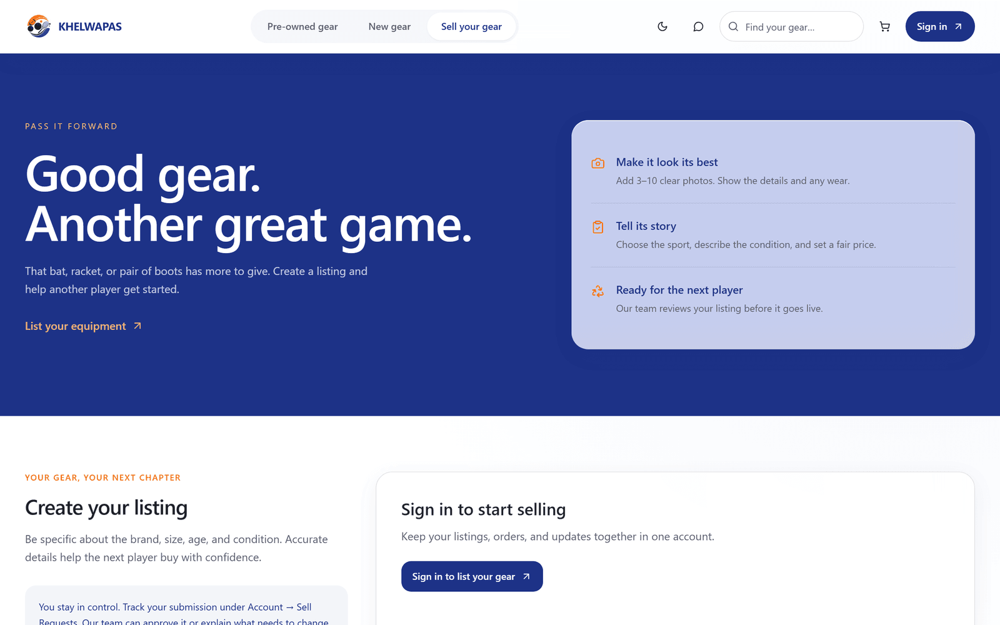
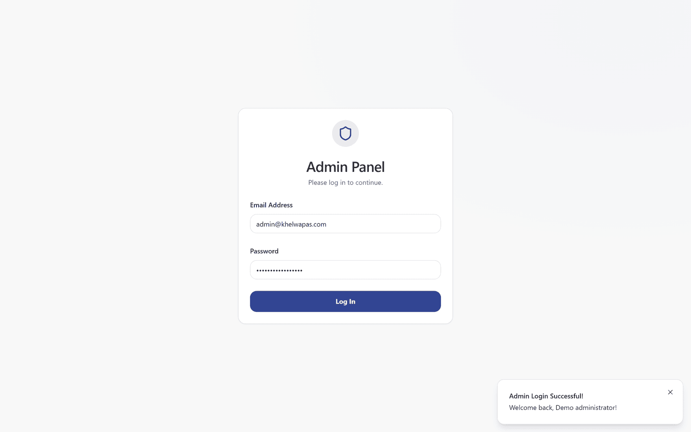
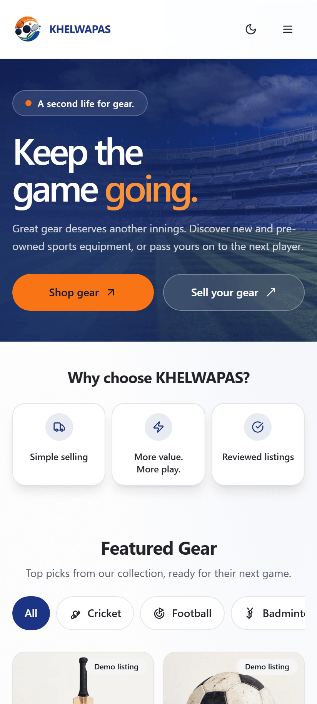

<div align="center">

  

  # ⚡ KhelWapas (खेल वापस)
  ### **The Next-Gen Circular Sports Re-Commerce Marketplace**

  *Empowering athletes to buy verified gear, pass forward used equipment, and play sustainably.*

  <p align="center">
    <a href="#-quick-start-guide"><b>Quick Start</b></a> •
    <a href="#-visual-tour"><b>Visual Tour</b></a> •
    <a href="#-core-capabilities--highlights"><b>Features</b></a> •
    <a href="#-demo-access--roles"><b>Demo Access</b></a> •
    <a href="#%EF%B8%8F-tech-stack--architecture"><b>Architecture</b></a> •
    <a href="#%EF%B8%8F-available-npm-scripts"><b>Commands</b></a>
  </p>

  <p align="center">
    
    
    
    
    
    
    
  </p>

  <!-- Hero Preview Banner -->
  <br />
  
  <br />
</div>

---

## 🌟 What is KhelWapas?

**KhelWapas** (*"Play Again"*) is a modern, high-performance circular marketplace prototype crafted to solve the barrier of expensive sports equipment. Built with **Next.js 15 App Router**, **TypeScript**, **Tailwind CSS**, and **Prisma**, it provides a fluid, liquid-glass re-commerce experience where players can buy inspected gear, trade in equipment they have outgrown, and calculate fair asking prices with intelligent estimation tools.

### 🎯 The Core Experience:
- 🛒 **For Buyers**: Browse 110+ verified sports items across 22 disciplines, view certified condition grades (A/B/C/D), transparent specs, and simulated express checkout.
- ♻️ **For Sellers**: Effortless trade-in flow with multi-photo upload, instant asking-price estimators, and automated pickup dispatch.
- 🛡️ **For Admins**: Comprehensive moderation portal to review incoming seller listings, oversee stock inventory, track simulated logistics, and manage orders.

---

## 📸 Visual Tour

<div align="center">
  <table>
    <tr>
      <td width="50%" align="center">
        <b>🛍️ Explore & Filter Equipment</b><br />
        <sub>Multi-sport filtering, instant search, condition badges, and price sorting</sub><br /><br />
        
      </td>
      <td width="50%" align="center">
        <b>🔍 Comprehensive Product Details</b><br />
        <sub>Condition grading, AI imagery disclosure, specifications & instant add-to-cart</sub><br /><br />
        
      </td>
    </tr>
    <tr>
      <td width="50%" align="center">
        <b>🔄 Sell & Trade-in Hub</b><br />
        <sub>Simple photo upload, condition disclosures, and integrated asking price estimator</sub><br /><br />
        
      </td>
      <td width="50%" align="center">
        <b>⚡ Admin Operations Dashboard</b><br />
        <sub>Real-time listing moderation, order tracking, pickup scheduling & inventory oversight</sub><br /><br />
        
      </td>
    </tr>
  </table>

  <br />

  <table>
    <tr>
      <td align="center">
        <b>📱 Mobile-First Responsive Experience</b><br />
        <sub>Adaptive two-column layout, bottom application dock, gesture navigation, and touch-optimized controls</sub><br /><br />
        
      </td>
    </tr>
  </table>
</div>

---

## ✨ Core Capabilities & Highlights

| Feature | Description |
| :--- | :--- |
| **🎨 Peak Design System** | Modern navy & orange palette, glassmorphism (`liquid-glass`), dark/light theme switching, and smooth GSAP micro-interactions with reduced-motion accessibility. |
| **📦 110-Item Demo Catalog** | Pre-populated across **22 sports disciplines** (Cricket, Football, Badminton, Tennis, Cycling, Fitness, Rugby, Golf, Boxing, etc.) with custom illustrations and SKUs. |
| **💡 Smart Price Estimator** | Algorithmic valuation engine that evaluates equipment category, brand tier, age, and condition grade to suggest competitive market rates. |
| **🤖 Contextual KhelBot** | Instant client-side AI support assistant answering equipment guidelines, sizing advice, seller FAQs, and return policies. |
| **🛡️ Robust Server Integrity** | Strict server-side authorization, transactional stock reserves, idempotency protection, and simulated checkout pipelines. |
| **📄 Automated Invoicing** | Dynamic, printable client-side PDF/print invoice generation with order breakdown, mock GST calculation, and tracking IDs. |
| **📱 Mobile Navigation Dock** | Native app-like floating dock on mobile viewports for quick switching between Shop, Sell, Cart, and Profile. |

---

## 🚀 Quick Start Guide

Get KhelWapas running locally in less than 2 minutes.

### 1. Prerequisites
- **Node.js**: `v22.x` or `v24.x`
- **npm**: `v10.x` or later

### 2. Clone & Install
```bash
# Clone the repository
git clone https://github.com/vinitgirdhar/KhelWapas.git

# Enter the directory
cd KhelWapas

# Install dependencies & generate Prisma client
npm install
```

### 3. Setup Environment Variables
Copy the example environment configuration:
```bash
cp .env.example .env
```

> [!TIP]
> Generate a secure `JWT_SECRET` with: `node -e "console.log(require('crypto').randomBytes(32).toString('hex'))"`

Your `.env` should look like this:
```env
DATABASE_URL="file:./prototype.db"
JWT_SECRET="your-generated-32-byte-hex-secret"
APP_URL="http://localhost:9002"
DEMO_ADMIN_EMAIL="admin@khelwapas.com"
DEMO_ADMIN_PASSWORD="AdminPassword123!"
```

### 4. Initialize Database & Seed Catalog
```bash
# Apply Prisma database migrations
npm run db:migrate

# Seed 110 demo products across 22 categories
npm run db:seed:mocks
```

### 5. Launch Development Server
```bash
npm run dev
```
Open [**http://localhost:9002**](http://localhost:9002) in your browser.

---

## 🔑 Demo Access & Roles

The prototype provides pre-seeded accounts and zero-setup authentication for testing:

| Role | Access URL | Credentials | Purpose |
| :--- | :--- | :--- | :--- |
| **Admin** | [`/admin/login`](http://localhost:9002/admin/login) | `admin@khelwapas.com` / `AdminPassword123!` | Review listings, schedule pickups, view orders |
| **Buyer / Seller** | [`/login`](http://localhost:9002/login) | Click **"Demo Login"** or Register | Browse items, add to cart, checkout, list equipment |

*(Optional)* Run `npm run db:seed:demo` to populate realistic simulated transaction history (16 orders, 12 seller submissions, and 4 scheduled pickups across fictional users).

---

## 🏗️ Tech Stack & Architecture

```
KhelWapas/
├── 🌐 src/
│   ├── app/                 # Next.js 15 App Router pages, layouts & API endpoints
│   ├── components/          # Reusable UI primitives, liquid-glass cards & forms
│   │   ├── home/            # Hero, featured carousels & category highlights
│   │   ├── layout/          # Header, footer, search bar & mobile dock
│   │   ├── khelbot/         # Contextual guidance chatbot
│   │   └── ui/              # Radix UI headless components styled with Tailwind
│   ├── data/                # Static sports metadata & catalog definitions
│   ├── hooks/               # Custom React hooks (auth, cart, storage, media query)
│   ├── lib/                 # Shared validation schemas, formats & client utilities
│   ├── server/              # Server actions, Prisma client & business logic
│   └── types/               # TypeScript interfaces & API contracts
├── 🗄️ prisma/                # SQLite schema, migration history & seed scripts
├── 📂 public/               # Optimized demo catalog imagery & branding assets
├── 🧪 tests/                # Unit test suites & Playwright E2E browser tests
└── 📜 docs/                 # Catalog production guides & screenshot assets
```

### Key Technologies:
- **Framework**: [Next.js 15](https://nextjs.org/) (App Router, Server Actions, Route Handlers)
- **UI & Styling**: [React 18](https://react.dev/), [Tailwind CSS](https://tailwindcss.com/), [Radix UI](https://www.radix-ui.com/)
- **Animations**: [GSAP](https://greensock.com/gsap/) with accessibility-first reduced-motion checks
- **Database & ORM**: [SQLite](https://www.sqlite.org/) + [Prisma ORM](https://www.prisma.io/)
- **Testing**: [Playwright](https://playwright.dev/) for headless end-to-end browser workflows

---

## 🛠️ Available NPM Scripts

| Command | Action |
| :--- | :--- |
| `npm run dev` | Starts local dev server at `http://localhost:9002` |
| `npm run build` | Builds optimized production bundle |
| `npm start` | Runs the production build (`next start`) |
| `npm run typecheck` | Validates TypeScript types across the entire project |
| `npm run db:migrate` | Deploys all pending Prisma database migrations |
| `npm run db:seed:mocks` | Populates the 110-product demonstration catalog |
| `npm run db:seed:demo` | Seeds multi-user transactional mock history |
| `npm run db:remove-mocks`| Safely archives mock catalog items |
| `npm run test:unit` | Executes Node test runner unit tests |
| `npm test` | Runs Playwright E2E integration test suite |

---

## 🔒 Prototype Disclosures & Safety

> [!NOTE]
> **Marketplace Simulation Notice**: KhelWapas is currently a fully-functional prototype. Financial transactions, courier pickups, returns, and payout processes are simulated in-memory and in SQLite. No actual banking data or card details are charged or stored.

---

<div align="center">
  <sub>Crafted with passion for sports and circular commerce. Built by Vinit Girdhar and contributors.</sub>
</div>
